# 🎮 AlgoQuest


> Transformando o aprendizado de Algoritmos e Estruturas de Dados em uma experiência gamificada e interativa.

## 📖 Sobre o Projeto

O **AlgoQuest** é um software educacional desenvolvido como projeto acadêmico. Conteúdos de algoritmos (notação Big O, árvores, tabelas hash) costumam ser apresentados de forma abstrata; aqui o usuário resolve desafios contextuais, recebe feedback educacional e ganha pontos, XP e nível. A API é Spring Boot (JDBC puro) e o frontend é HTML/CSS/JavaScript puro, sem build.

---

---

## 🖼️ Visão geral da interface

Abaixo estão algumas telas principais do AlgoQuest. As imagens ficam na pasta [`screenshots/`](screenshots/), localizada na raiz do repositório.

<table>
  <tr>
    <td width="50%" align="center">
      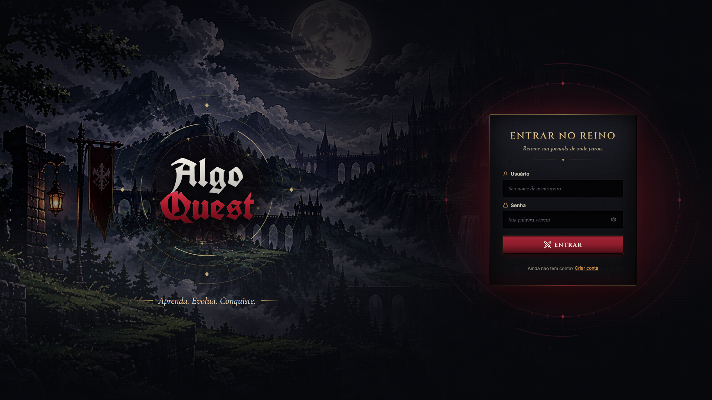
      <br>
      <strong>🔐 Login</strong>
    </td>
    <td width="50%" align="center">
      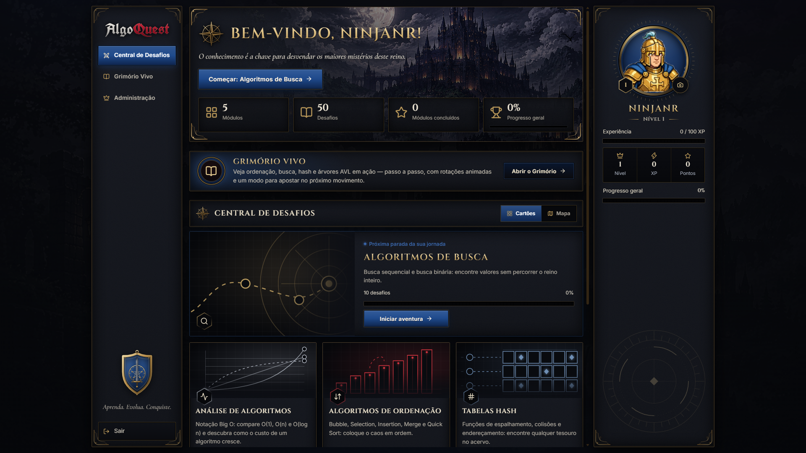
      <br>
      <strong>🏠 Home</strong>
    </td>
  </tr>
  <tr>
    <td width="50%" align="center">
      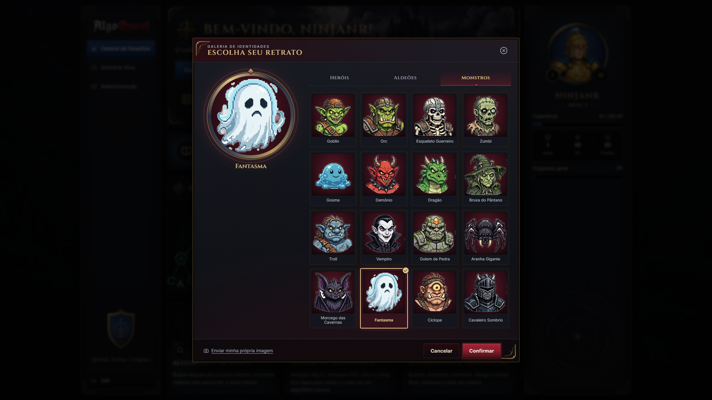
      <br>
      <strong>🧙 Avatar</strong>
    </td>
    <td width="50%" align="center">
      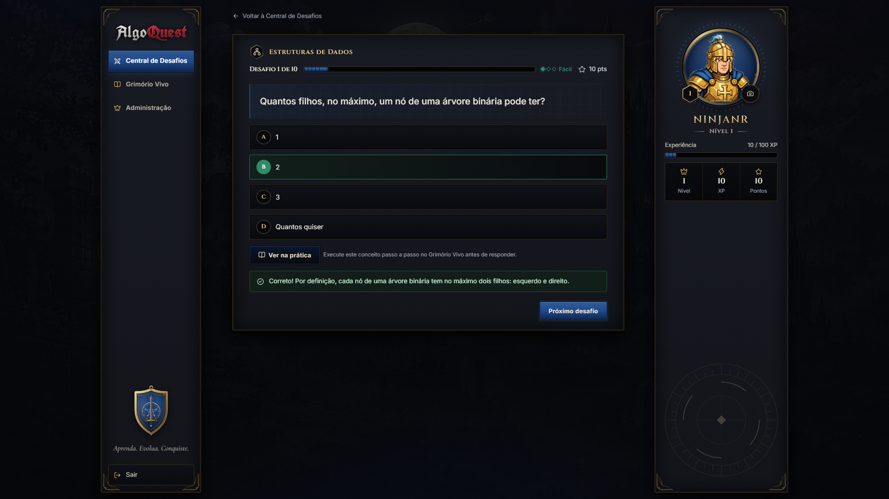
      <br>
      <strong>📚 Módulo e Exercícios</strong>
    </td>
  </tr>
  <tr>
    <td width="50%" align="center">
      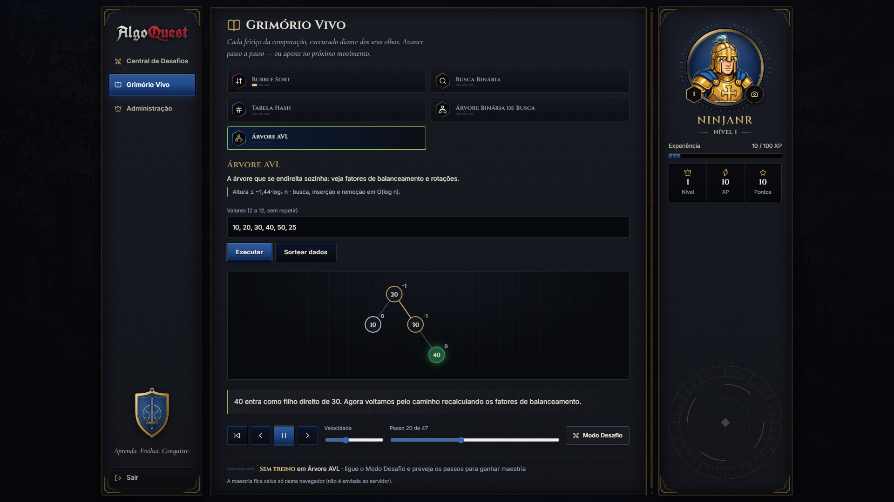
      <br>
      <strong>🔮 Grimório Vivo</strong>
    </td>
    <td width="50%" align="center">
      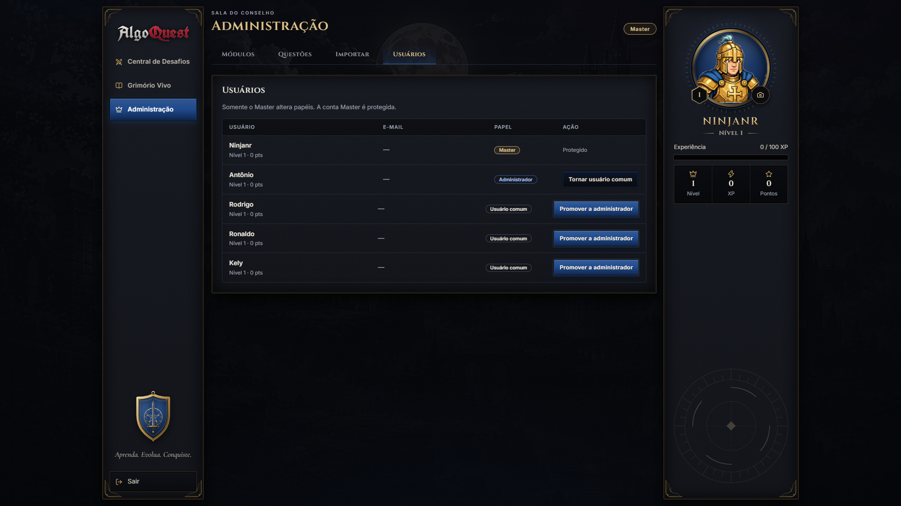
      <br>
      <strong>⚙️ Administração Mestre</strong>
    </td>
  </tr>
</table>

---

## 🔮 Grimório Vivo (simuladores visuais)

Página `frontend/laboratorio.html` com simulações **passo a passo, em português**: Bubble Sort, Busca Binária, Tabela Hash (encadeamento), Árvore Binária de Busca e Árvore AVL (fatores de balanceamento e rotações animadas). Recursos: reproduzir/pausar/voltar/linha do tempo, dados editáveis, **Modo Desafio** (preveja o próximo passo para ganhar maestria — Noviço, Adepto, Mestre) e **ordenar à mão** (Bubble Sort). Nos exercícios, o botão **Ver na prática** abre o simulador correspondente. Frontend puro (sem build); a maestria fica no `localStorage`. Testes: `node dev-tools/testes/lab-sims.test.js`.

---

## 🧠 Estrutura Educacional (Módulos)

O conteúdo é organizado em trilhas de aprendizagem. Os módulos iniciais (5 módulos × 10 exercícios no banco) são os abaixo; administradores podem criar outros pelo painel:

*   📊 **Análise de Algoritmos:** Notação Big O (O(1), O(n), O(log n), etc).
*   🔎 **Algoritmos de Busca:** Busca sequencial vs. Busca binária.
*   🔃 **Algoritmos de Ordenação:** Bubble, Selection, Insertion, Merge e Quick Sort.
*   #️⃣ **Tabelas Hash:** Funções, colisões e endereçamento.
*   🌳 **Estruturas de Dados:** Árvores binárias, de busca e balanceamento.

---

## 🎮 A Experiência do Usuário (Gamificação)

A gamificação existe para incentivar, sem tornar o sistema um jogo complexo. O fluxo padrão consiste em:

1. **Escolha do Módulo:** O usuário acessa seu painel e visualiza seu progresso (ex: *Busca: 90% concluído*).
2. **O Desafio:** O sistema apresenta um cenário (ex: *"Você tem 1.000.000 de elementos ordenados. Como achar um valor rapidamente?"*).
3. **Resolução e Feedback:** Após a resposta, o sistema não apenas diz se está certo ou errado, mas fornece uma **explicação educacional**.
4. **Recompensa:** Acertos geram pontos baseados na dificuldade (Fácil: +10, Médio: +20, Difícil: +30) e aumentam o XP/Nível do perfil.

---

## 📁 Estrutura do projeto

```
AlgoQuest/
├── screenshots/           imagens das principais telas do sistema
├── pom.xml · docker-compose.yml · .env.example
├── database/00_criar_banco_postgresql.sql   cria banco e usuário no PostgreSQL instalado
├── src/main/java/algoquest/
│   ├── controller/   HTTP: recebe JSON, delega ao serviço (sem regra, sem SQL)
│   ├── service/      regras, transações e permissões
│   ├── repository/   SQL parametrizado (JdbcTemplate)
│   ├── model/        domínio e regras puras (Usuario, Modulo, Exercicio, Papel, validações)
│   ├── dto/          contrato JSON de entrada e saída
│   ├── config/       CORS, autenticação por token, Master inicial
│   ├── exception/    ErroApi e formato único de erro
│   └── util/         HashSenha (PBKDF2, tokens)
├── src/main/resources/   application.properties e db/migration (Flyway V1…V5)
├── src/test/java/        testes JUnit (domínio, regras, hash e API sobre H2 em memória)
├── frontend/             View: páginas, css/, js/ e assets/
├── docs/                 ARQUITETURA.md, diagramas/ (.mmd, .svg, .png) e exemplo-importacao.json
├── tools/gerar_avatares.py   gera retratos, catálogo JS e AvatarIds.java
└── dev-tools/            mock da API e testes de interface (Playwright), teste dos simuladores (Node)
```

No MVC do projeto, **View** é o `frontend/`, **Controller** é o pacote `controller` (com `service` como camada de aplicação) e **Model** reúne `model`, `repository` e o banco.

---

## 🏗️ Arquitetura e Modelagem

Esta seção é o **documento de referência do sistema**: explica como as peças se organizam, por que cada regra existe e onde ela mora no código. Os diagramas são escritos em Mermaid (o GitHub os desenha sozinho); a fonte de cada um está em [`docs/diagramas/*.mmd`](docs/diagramas), com `.svg` e `.png` renderizados na mesma pasta (veja [Mantendo os diagramas](#mantendo-os-diagramas)).

O AlgoQuest é uma API REST em **Java + Spring Boot** (JDBC puro, sem JPA) com frontend em **HTML/CSS/JavaScript puro**, organizada em camadas: *Controller → Service → Repository → Banco*, com o **Domínio** (`model`) no centro e uma camada de **Infraestrutura** transversal.

### 1. Visão geral por camadas

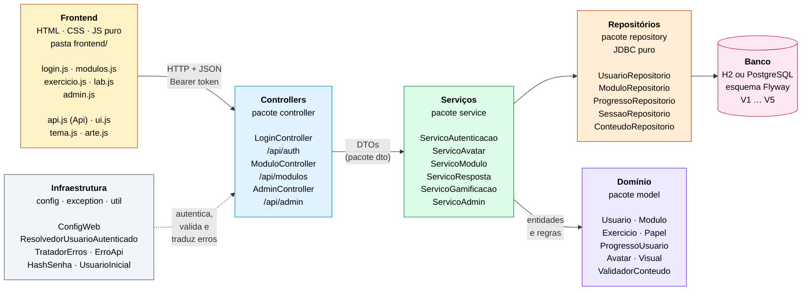

| Camada | Pacote | Responsabilidade | O que **não** faz |
|---|---|---|---|
| Frontend | `frontend/` | Telas, chamadas à API (`api.js`), tema visual e simuladores | Não decide permissões: só adapta a tela (o servidor autoriza) |
| Controller | `controller` | Recebe HTTP, converte JSON ⇄ DTO, delega ao serviço | Sem regra de negócio, sem SQL |
| Serviço | `service` | Orquestra regras, transações e permissões | Não monta SQL nem conhece HTTP |
| Domínio | `model` | Entidades e regras puras (nível, verificação de resposta, validações, papéis) | Não depende de Spring nem de banco |
| Repositório | `repository` | SQL parametrizado com `JdbcTemplate` | Não decide regra de negócio |
| DTO | `dto` | Contrato JSON de entrada e saída (`record`s imutáveis) | Nunca expõe entidade nem gabarito indevido |
| Infraestrutura | `config`, `exception`, `util` | Autenticação por token, CORS, tratamento de erros, hash de senha, criação do Master | — |

### 2. Domínio (`model`)

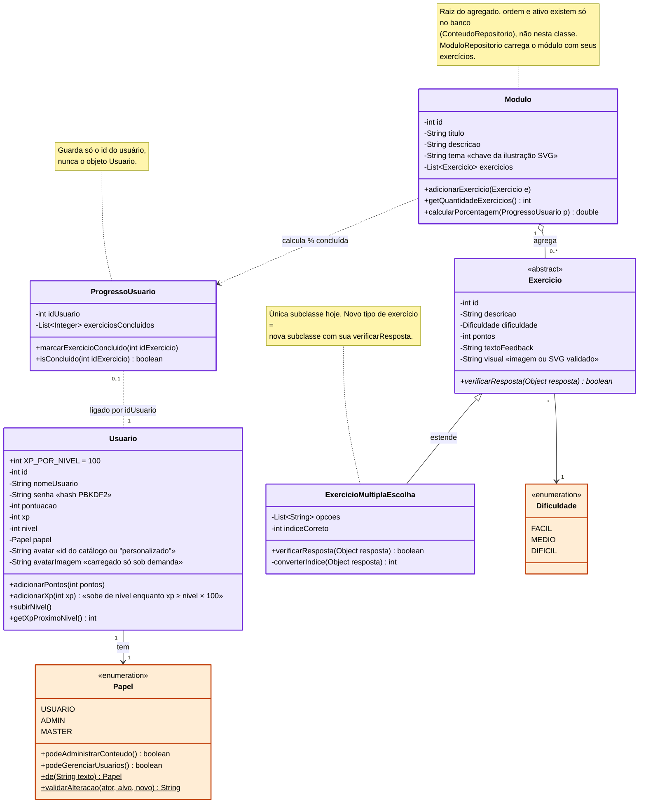

- **`Usuario`** guarda pontos, XP e nível. O nível sobe **enquanto `xp ≥ nivel × 100`** (`adicionarXp`), então um ganho grande pode subir vários níveis de uma vez. Carrega também o `papel` e o `avatar`.
- **`Modulo`** é a **raiz do agregado**: contém seus `Exercicio`s e calcula a porcentagem concluída (`concluídos ÷ total`). `ordem` e `ativo` existem só no banco (são geridos por `ConteudoRepositorio`); `tema` é a chave da ilustração SVG.
- **`Exercicio`** é abstrato; cada tipo implementa `verificarResposta`. Hoje só existe `ExercicioMultiplaEscolha` (compara com `indiceCorreto`). O campo `visual` guarda uma imagem ou um SVG validado.
- **`ProgressoUsuario`** guarda só o **id** do usuário e os ids dos exercícios concluídos — nunca o objeto `Usuario`.
- **`Papel`** é um enum **com comportamento**: `podeAdministrarConteudo()`, `podeGerenciarUsuarios()` e a regra de alteração de papéis (`validarAlteracao`).

#### Regras puras (sem Spring, testáveis só com o JDK)

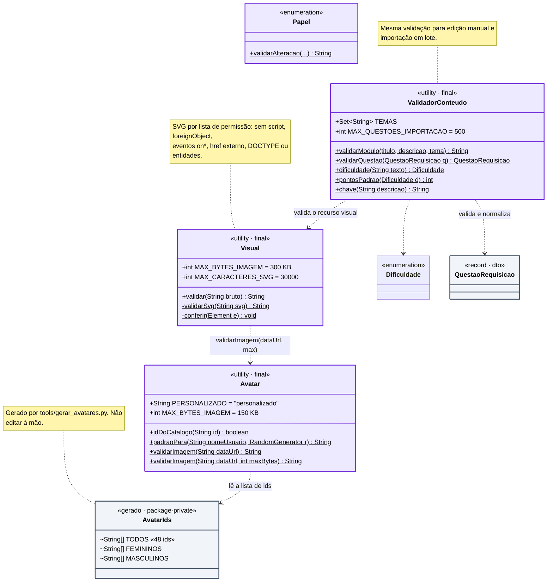

`Avatar`, `Visual` e `ValidadorConteudo` são classes utilitárias `final`, sem estado. Por isso a **mesma validação** vale para edição manual e importação em lote, e dá para testá-las sem subir o servidor (`dev-tools/testes/java/RegrasAdmin.java`).

### 3. Controllers e serviços

Três fatias por funcionalidade (os serviços compartilham repositórios, então um diagrama único ficaria ilegível).

#### 3.1 Autenticação e avatar

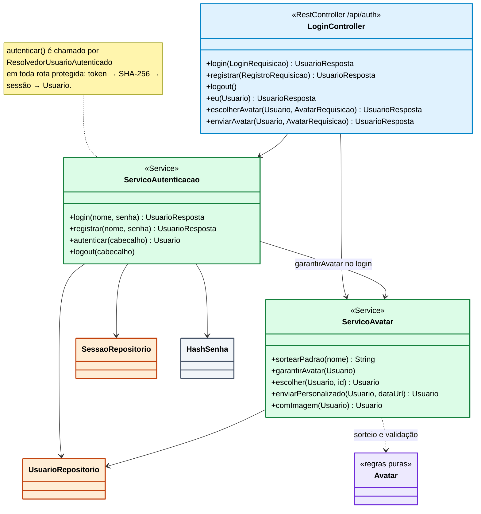

#### 3.2 Aprendizado (módulos, exercícios, gamificação)

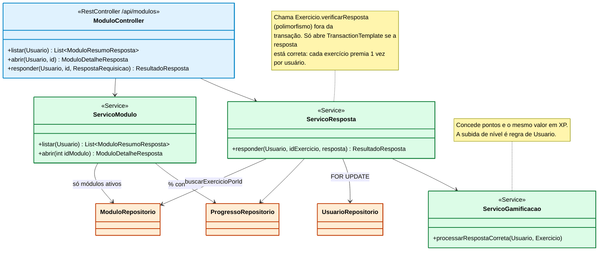

#### 3.3 Administração

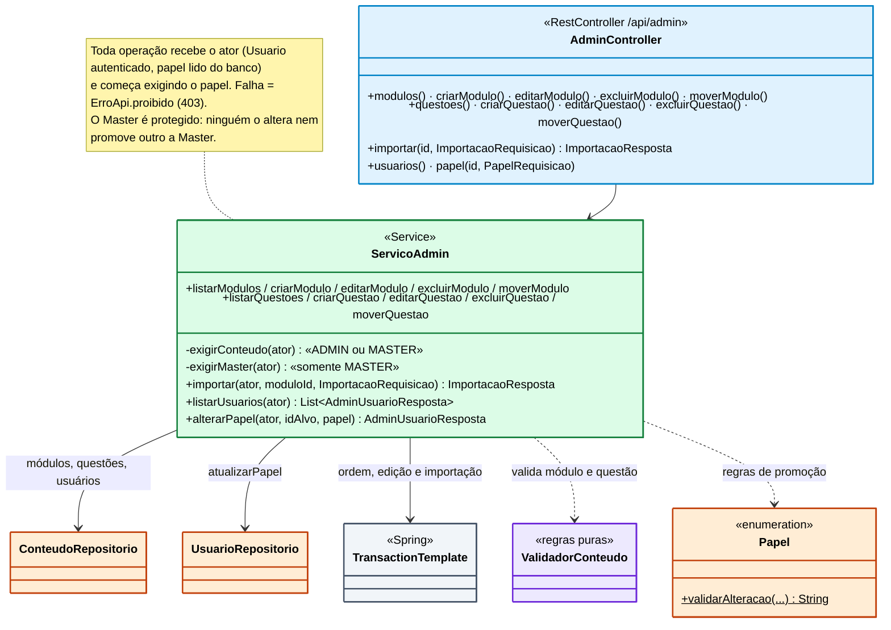

#### API HTTP

| Rota | Quem acessa | O que faz |
|---|---|---|
| `POST /api/auth/login` · `POST /api/auth/registrar` | público | Entra / cria conta (devolve token; cadastro sempre cria `USUARIO`) |
| `POST /api/auth/logout` · `GET /api/auth/me` | logado | Encerra a sessão / dados do usuário (inclui `papel` e `avatar`) |
| `POST /api/auth/me/avatar` · `POST /api/auth/me/avatar/personalizado` | logado | Escolhe retrato do catálogo / envia imagem própria |
| `GET /api/modulos` · `GET /api/modulos/{id}` | logado | Lista com % de progresso / abre um módulo (só módulos ativos; sem gabarito) |
| `POST /api/modulos/exercicios/{id}/resposta` | logado | Responde; devolve acerto, explicação, pontos e usuário atualizado |
| `/api/admin/modulos…` · `/api/admin/questoes…` | `ADMIN`, `MASTER` | CRUD, ordem e importação de módulos e questões |
| `GET /api/admin/usuarios` · `PUT /api/admin/usuarios/{id}/papel` | **só `MASTER`** | Lista usuários / promove ou rebaixa entre `USUARIO` e `ADMIN` |

Erros seguem sempre `{"erro": "mensagem"}` com `400` (dado inválido), `401` (sem sessão), `403` (sem permissão), `404`, `409` (conflito, ex.: nome já usado) ou `500`.

### 4. Persistência

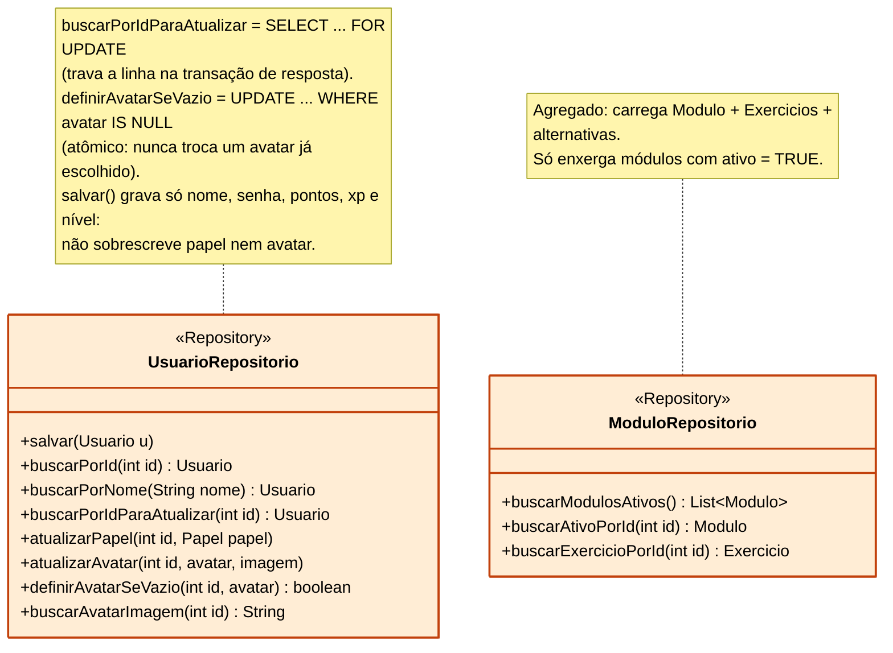

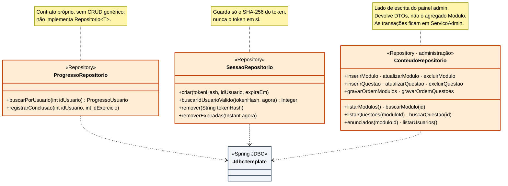

Cada repositório tem contrato próprio, sem interface genérica de CRUD: o que cada um expõe é só o que os serviços usam.

#### Modelo do banco

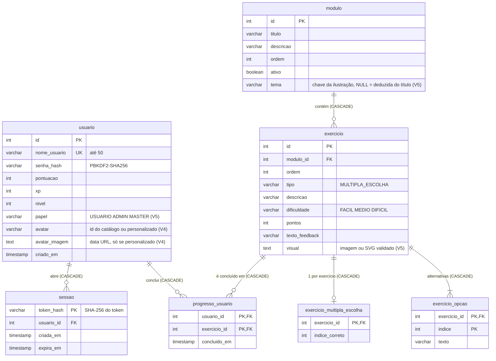

O esquema é criado pelo Flyway (`V1`…`V5`): `V1` esquema, `V2`/`V3` conteúdo inicial (5 módulos × 10 exercícios), `V4` avatar, `V5` papéis, tema do módulo e visual da questão. Todas as chaves estrangeiras são `ON DELETE CASCADE`: **excluir um módulo ou questão apaga também alternativas e o progresso dos jogadores nela** (pontos já ganhos não são revertidos).

### 5. Contrato da API (DTOs)

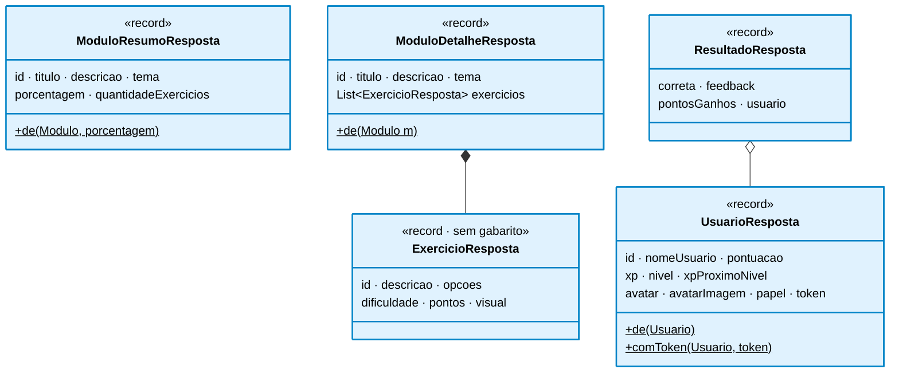

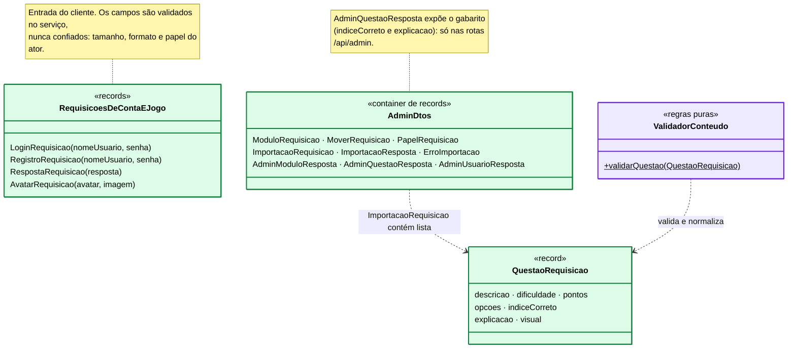

Dois cuidados de segurança vivem aqui: `ExercicioResposta` **não tem** `indiceCorreto` nem explicação (o gabarito só volta em `ResultadoResposta`, depois de responder), e `UsuarioResposta` só leva `token` no login/cadastro e `avatarImagem` só quando o avatar é personalizado. Apenas as rotas `/api/admin` devolvem o gabarito (`AdminQuestaoResposta`).

### 6. Infraestrutura: autenticação, erros e segurança

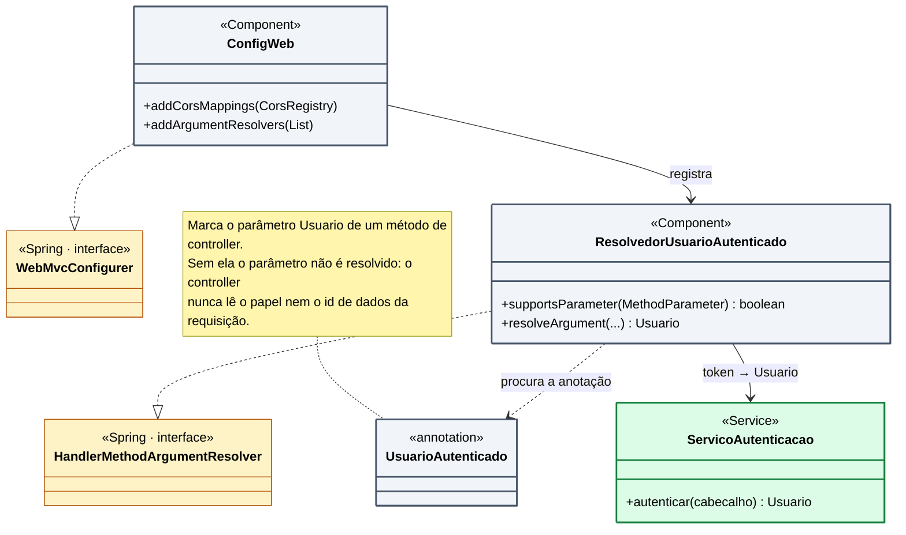

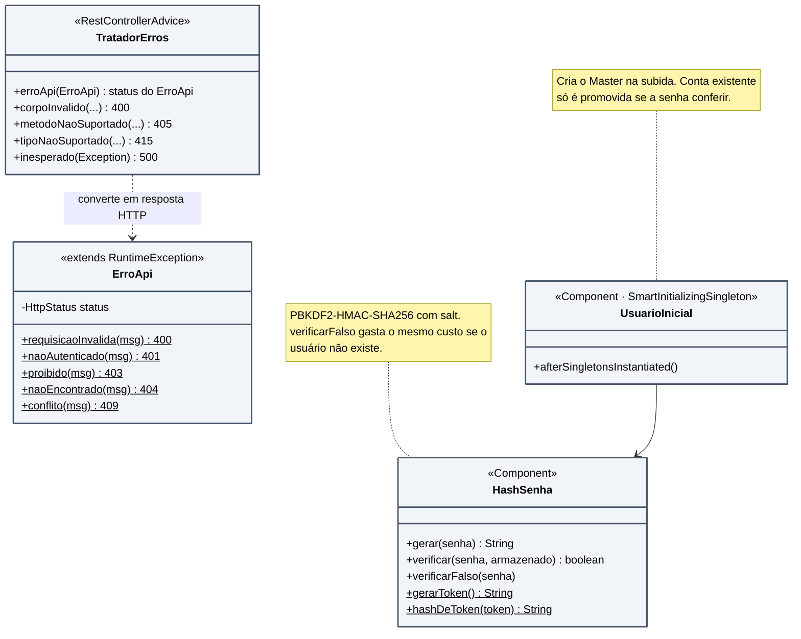

- **Autenticação por token:** o login gera um token aleatório; o banco guarda **só o SHA-256** dele (`sessao.token_hash`), com validade de 12 h (`ALGOQUEST_SESSAO_HORAS`). Em cada rota protegida, `ResolvedorUsuarioAutenticado` transforma o cabeçalho `Authorization: Bearer …` em um `Usuario` carregado **do banco**.
- **Senhas:** PBKDF2-HMAC-SHA256 com salt aleatório (600 000 iterações por padrão), comparação em tempo constante. Se o usuário não existe, `verificarFalso` gasta o mesmo custo, para o tempo de resposta não revelar quais nomes existem.
- **Master:** `UsuarioInicial` cria o Master na subida a partir de `ALGOQUEST_USUARIO_INICIAL`/`..._SENHA_INICIAL`. Se a conta já existe, só é promovida quando a senha informada confere (evita promover quem cadastrou o mesmo nome antes). Não há outro caminho para criar um Master.

### 7. Fluxos (como as camadas colaboram)

#### 7.1 Autenticação e permissões por papel

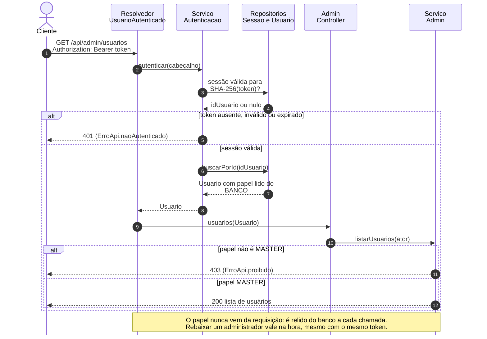

O papel **nunca** vem da requisição: é relido do banco a cada chamada. Por isso rebaixar um administrador vale imediatamente, mesmo que ele continue com o mesmo token. O frontend só esconde botões; o servidor responde `403` a qualquer chamada sem o papel exigido.

#### 7.2 Cadastro e avatar padrão

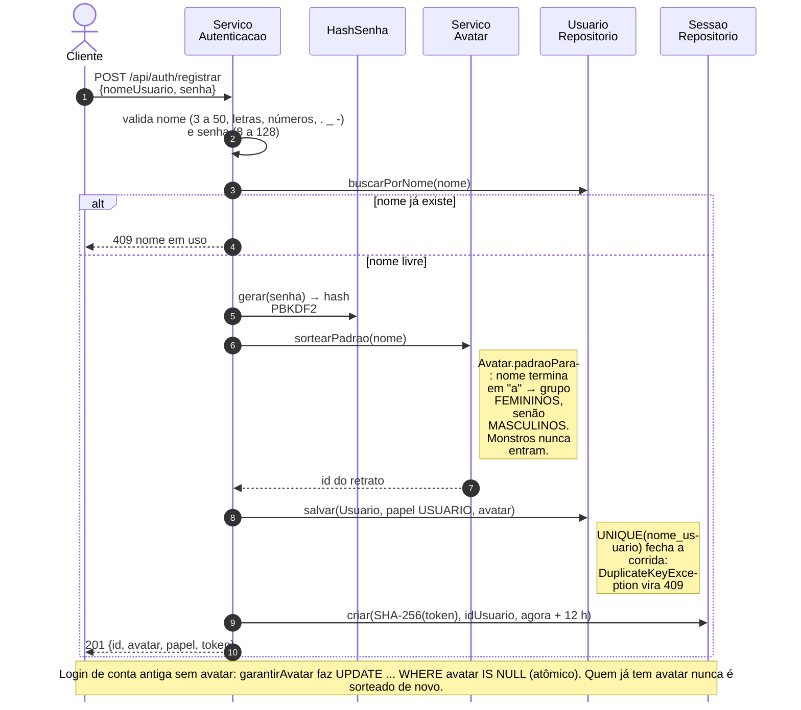

#### 7.3 Responder um exercício

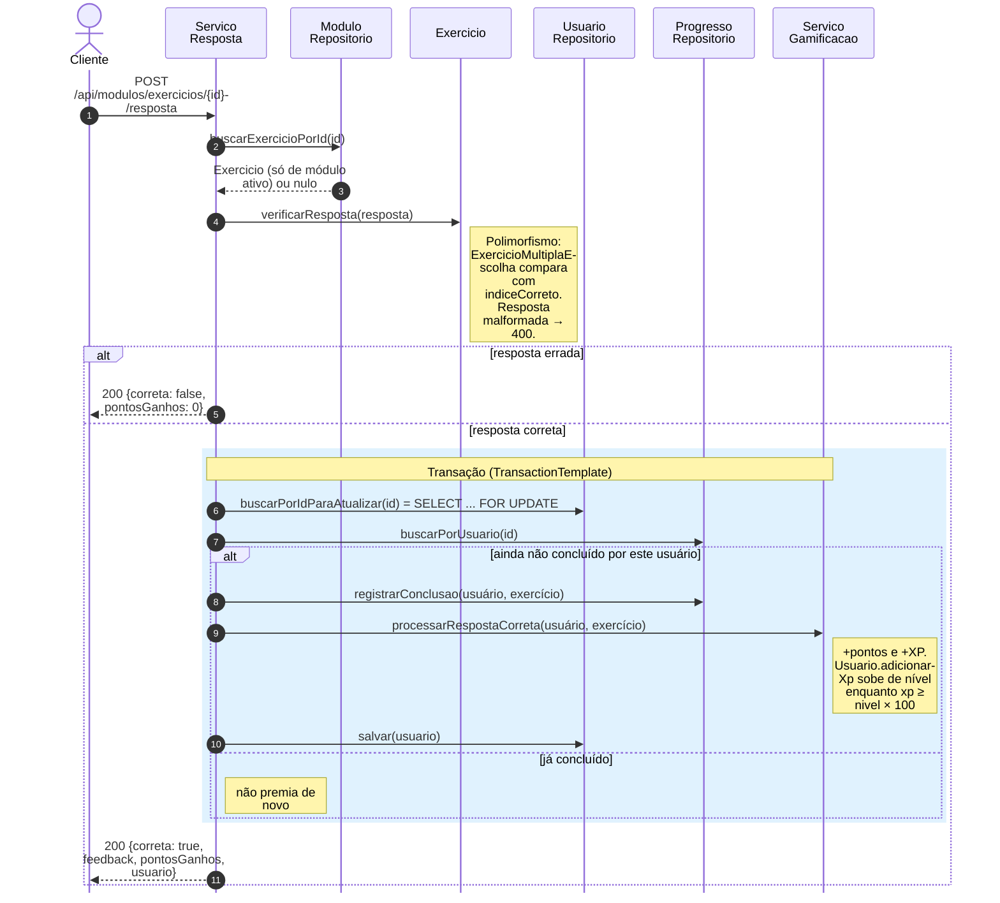

A resposta é verificada **fora** da transação; a transação só abre quando está correta. Dentro dela, `SELECT … FOR UPDATE` trava a linha do usuário e o registro de conclusão garante que **cada exercício premia uma única vez**, mesmo com dois cliques simultâneos.

#### 7.4 Importação de questões em lote

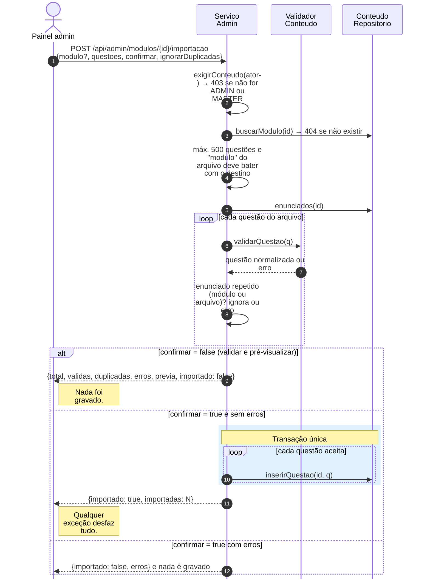

### 8. Regras de negócio em um só lugar

| Tema | Regra | Onde está |
|---|---|---|
| Pontos | Fácil 10 · Médio 20 · Difícil 30 (padrão; o admin pode definir 1–1000) | `ValidadorConteudo.pontosPadrao` |
| Recompensa | Resposta correta dá **pontos e o mesmo valor em XP**, uma vez por exercício | `ServicoGamificacao`, `ServicoResposta` |
| Nível | Sobe enquanto `xp ≥ nivel × 100` | `Usuario.adicionarXp` |
| Progresso | `concluídos ÷ total` do módulo | `Modulo.calcularPorcentagem` |
| Módulo inativo | Some da Central e não aceita respostas | `ModuloRepositorio` (`ativo = TRUE`) |
| Papéis | `USUARIO` joga · `ADMIN` + gere módulos/questões · `MASTER` + gere papéis. Só o Master altera papéis, só entre `USUARIO` e `ADMIN`; não altera a si mesmo nem o Master | `Papel`, `ServicoAdmin` |
| Avatar padrão | Nome terminando em "a" → retrato feminino sorteado; demais → masculino; **monstros nunca** entram no sorteio. Só na criação da conta ou se ainda não houver avatar | `Avatar.padraoPara`, `ServicoAvatar.garantirAvatar` |
| Imagem própria | JPEG/PNG/WebP até 150 KB, validada no servidor | `Avatar.validarImagem` |
| Tema visual (frontend) | A **categoria** do retrato (Heróis, Aldeões, Monstros) define a paleta de todo o app; imagem própria mantém o tema neutro | `frontend/js/tema.js`, `frontend/css/tema.css` |
| Questão | 2–6 alternativas, 1 correta, enunciado 5–1000 caracteres, visual opcional (imagem ≤ 300 KB ou SVG por lista de permissão) | `ValidadorConteudo`, `Visual` |
| Importação | Um módulo por vez, até 500 questões, tudo-ou-nada, duplicatas ignoradas | `ServicoAdmin.importar` |

### 9. Padrões de projeto (verificados no código)

> Esta seção foi revisada contra os fontes. Só aparece aqui o que **existe de fato**; o que não existe está listado logo abaixo, para ninguém procurar.

**Padrões presentes**

| Padrão | Onde | Para quê |
|---|---|---|
| **Herança + polimorfismo** | `Exercicio` (abstrata, `verificarResposta`) → `ExercicioMultiplaEscolha` | `ServicoResposta` só conhece `Exercicio`; um novo tipo de exercício é uma nova subclasse, sem mexer no serviço |
| **Repository** | `UsuarioRepositorio`, `ModuloRepositorio`, `ProgressoRepositorio`, `SessaoRepositorio`, `ConteudoRepositorio` | Isola o SQL; a regra de negócio não sabe de tabelas |
| **Service Layer** | `Servico*` | Orquestra regras, transações e permissões; controllers ficam finos |
| **DTO** | `record`s do pacote `dto` | Contrato JSON imutável; esconde entidades e gabarito |
| **Static Factory Method** (*Effective Java*, item 1) | `UsuarioResposta.de/comToken`, `ModuloResumoResposta.de`, `ModuloDetalheResposta.de`, `ErroApi.proibido/conflito/…`, `Papel.de` | Nomes que explicam a criação; centraliza a montagem |
| **Agregado** (DDD) | Raiz `Modulo` contém `Exercicio`s; `ModuloRepositorio` carrega o conjunto | Exercícios só são acessados pelo módulo |
| **Injeção de dependência** | Construtores de `@Service`, `@Repository`, `@RestController`, `@Component` | Spring monta o grafo; testes montam à mão (`AmbienteTeste`) |
| **Bloqueio pessimista** | `UsuarioRepositorio.buscarPorIdParaAtualizar` (`SELECT … FOR UPDATE`) | Evita premiar duas vezes em respostas simultâneas |
| **Atualização condicional atômica** | `definirAvatarSeVazio` (`UPDATE … WHERE avatar IS NULL`) | Nunca troca um avatar já escolhido |
| **Enum com comportamento** | `Papel` | As regras de permissão moram junto dos papéis |
| **Classes utilitárias de regras puras** | `Avatar`, `Visual`, `ValidadorConteudo` | Regras sem estado, compartilhadas e testáveis sem Spring |

**Pontos de extensão e padrões do framework que o código usa**

| O quê | Onde | Observação |
|---|---|---|
| **Argument Resolver** (a *Strategy* do Spring MVC para parâmetros) | `ResolvedorUsuarioAutenticado` + `@UsuarioAutenticado` | O controller recebe o `Usuario` já autenticado, sem ler papel ou id da requisição |
| **Controller Advice** | `TratadorErros` | Converte `ErroApi` e erros comuns em JSON com o status certo |
| **Template Method + callback** (do Spring) | `JdbcTemplate` + `RowMapper`; `TransactionTemplate` em `ServicoResposta` e `ServicoAdmin` | O código usa os templates; não implementa o padrão por conta própria |
| **Hook de inicialização** | `UsuarioInicial` (`SmartInitializingSingleton`) | Cria/promove o Master na subida |
| **Singleton do contêiner** | Beans do Spring | É escopo gerenciado pelo Spring, **não** o Singleton do GoF |

**Padrões que NÃO existem no código** (e por isso não aparecem nos diagramas): Singleton (GoF), Strategy (GoF), Facade, Proxy, Chain of Responsibility, Command, Observer, Builder, Decorator, Adapter, State, Abstract Factory e o Factory Method do GoF. Em particular, `Papel` é um enum com regras, **não** o padrão State.

### 10. Frontend (mapa rápido)

| Arquivo | Papel | Organização |
|---|---|---|
| `js/api.js` | Cliente HTTP: injeta o token e traduz erros (`Api.login`, `Api.admModulos`, …) | Objeto único (*gateway* da API) |
| `js/ui.js` · `ui-base.js` | Sessão (`Sessao`), menu, perfil (`Perfil`). `ui-base.js` é a versão enxuta da tela de login | Objetos globais por arquivo |
| `js/tema.js` + `css/tema.css` | Aplica `data-tema="herois\|aldeoes\|monstros"` no `<html>`; paletas em variáveis CSS `--theme-*` | Única lógica de tema; sem `data-tema` = visual neutro |
| `js/arte.js` | Ilustrações SVG dos módulos (`TEMAS`, `arteSvg`), `temaDoModulo`, `visualSrc` | Tabela de temas por chave |
| `js/avatares.js` + `avatares-catalogo.js` | Galeria de retratos e recorte da imagem própria | Módulo por IIFE; catálogo gerado por `tools/gerar_avatares.py` |
| `js/modulos.js` · `exercicio.js` | Central de desafios e tela de exercício | Funções por página |
| `js/lab-sims.js` + `lab.js` | Grimório Vivo: simuladores passo a passo | `lab-sims.js` é lógica pura em `AQSims.SIMS` (tabela `id → simulador`, cada um gera uma lista de passos); `lab.js` só desenha |
| `js/admin.js` | Painel de administração | IIFE; o servidor autoriza cada chamada |

### Como estender

- **Novo tipo de exercício:** subclasse de `Exercicio` com `verificarResposta`, tabela própria como `exercicio_multipla_escolha` e um ramo em `ModuloRepositorio`.
- **Novo tema de módulo:** adicione a chave em `TEMAS`/`CORPOS` (`arte.js`) e em `ValidadorConteudo.TEMAS`.
- **Mudança no banco:** nova migração `V6__….sql` (nunca edite `V1`–`V5`: o Flyway recusa migrações alteradas) e atualize `docs/diagramas/06-modelo-banco.mmd`.
- **Novo retrato:** edite `CATALOGO` em `tools/gerar_avatares.py` e rode de novo (gera assets, catálogo JS e `AvatarIds.java`).

### Mantendo os diagramas

Edite o `.mmd` correspondente em `docs/diagramas`, copie o conteúdo para o bloco ```` ```mermaid ```` deste README e gere as imagens:

```bash
npx @mermaid-js/mermaid-cli -i docs/diagramas/NOME.mmd -o docs/diagramas/NOME.svg
npx @mermaid-js/mermaid-cli -i docs/diagramas/NOME.mmd -o docs/diagramas/NOME.png -s 2 -b white
```

---

## 🛠️ Executando

Pré-requisitos: JDK 17+ e Maven. O passo a passo completo para Windows/PowerShell está em [`docs/GUIA_ALGOQUEST.md`](docs/GUIA_ALGOQUEST.md).

```bash
export ALGOQUEST_USUARIO_INICIAL=seu_usuario
export ALGOQUEST_SENHA_INICIAL='uma-senha-forte-com-8+-caracteres'
mvn spring-boot:run
cd frontend && python3 -m http.server 5500
mvn test
node dev-tools/testes/lab-sims.test.js
```

A API sobe em `http://localhost:8080`; o frontend deve ser servido em uma origem permitida por `ALGOQUEST_CORS_ORIGENS` (padrão: `localhost` e `127.0.0.1` nas portas 5500 e 3000). O usuário inicial é criado como **Master** (único que gerencia papéis); qualquer pessoa também pode criar conta pela tela "Criar conta" (papel `USUARIO`).

### Variáveis de ambiente

Copie `.env.example` para `.env` (nunca versione o `.env` real) e exporte as variáveis antes de iniciar. Nenhuma credencial fica no código.

| Variável | Padrão | Função |
|---|---|---|
| `ALGOQUEST_DB_URL` · `ALGOQUEST_DB_USUARIO` · `ALGOQUEST_DB_SENHA` | H2 em `./data/algoquest` | Conexão com o PostgreSQL. Se `ALGOQUEST_DB_URL` estiver ausente (não defina vazia), usa H2 |
| `ALGOQUEST_USUARIO_INICIAL` · `ALGOQUEST_SENHA_INICIAL` | vazio | Cria (ou promove, se a senha conferir) o Master ao subir |
| `ALGOQUEST_PORTA` | `8080` | Porta da API |
| `ALGOQUEST_CORS_ORIGENS` | `localhost`/`127.0.0.1`, portas 5500 e 3000 | Origens do frontend |
| `ALGOQUEST_SESSAO_HORAS` | `12` | Validade do token |
| `ALGOQUEST_SENHA_ITERACOES` | `600000` | Iterações do PBKDF2 |

### Banco de dados

O esquema e o conteúdo inicial (5 módulos × 10 exercícios) são criados **uma única vez** pelo Flyway (`V1`…`V5` em `src/main/resources/db/migration`). Em um banco que já existe, nada é recriado nem repopulado; o Master inicial só é criado se ainda não existir.

- **H2 (padrão):** não exige configuração.
- **PostgreSQL via Docker:** defina `ALGOQUEST_DB_USUARIO` (padrão `postgres`) e `ALGOQUEST_DB_SENHA` no ambiente ou no `.env` e rode `docker compose up -d`; use os mesmos valores, mais `ALGOQUEST_DB_URL=jdbc:postgresql://localhost:5432/algoquest`, ao iniciar o backend. O volume guarda as credenciais da primeira criação.
- **PostgreSQL instalado:** `psql -U postgres -v senha="$ALGOQUEST_DB_SENHA" -f database/00_criar_banco_postgresql.sql` cria o banco e o usuário `algoquest`.

Para criar ou editar módulos e questões sem mexer no código, use o painel *Administração* (`admin.html`, com importação JSON; modelo em `docs/exemplo-importacao.json`).

## Avatares (retratos RPG + imagem própria)
- 48 retratos (Heróis, Aldeões, Monstros) em `frontend/assets/avatares/{p,g}/*.webp`; o catálogo (`frontend/js/avatares-catalogo.js`) e `AvatarIds.java` são gerados por `tools/gerar_avatares.py` (os PNG originais não vão no projeto por restrição de licença).
- Cadastro: nome terminado em "a" → retrato feminino sorteado; demais → masculino; monstros nunca entram no sorteio. Contas antigas sem avatar recebem um padrão uma única vez no login.
- Troca: `POST /api/auth/me/avatar {avatar}` e `POST /api/auth/me/avatar/personalizado {imagem}` (data URL JPEG/PNG/WebP ≤ 150 KB, validada no servidor).

## Administração (papéis, módulos, questões, importação)
O usuário definido em `ALGOQUEST_USUARIO_INICIAL` é o **Master**. Administradores e Master acessam `admin.html` para criar, editar, excluir e ordenar módulos e questões e importar bancos em JSON (um módulo por vez). Só o Master gerencia papéis.

---

👨‍💻 **Equipe:** Nygel & Antônio
